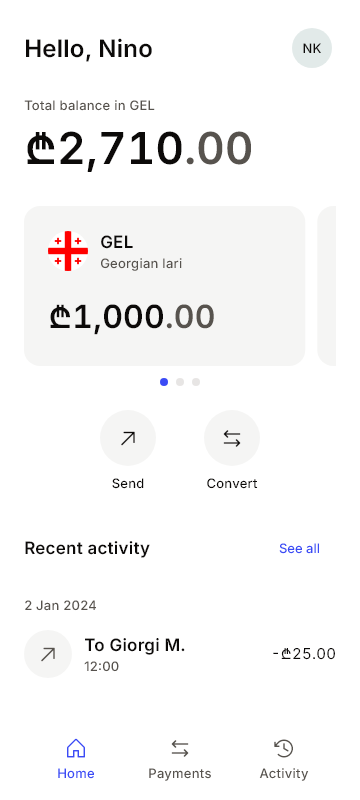
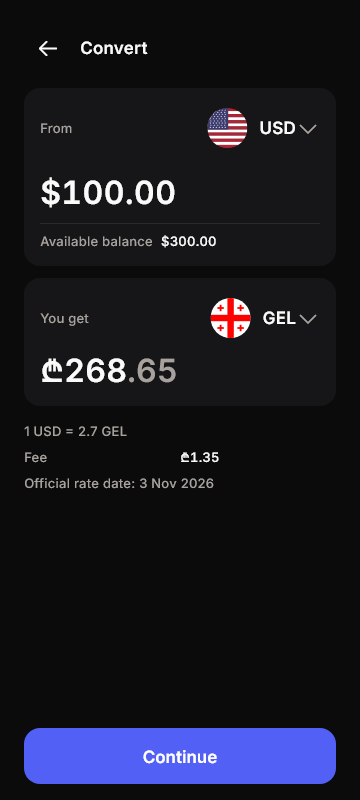
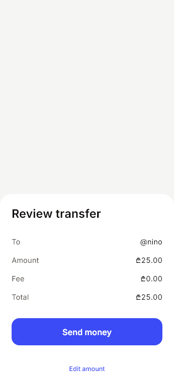
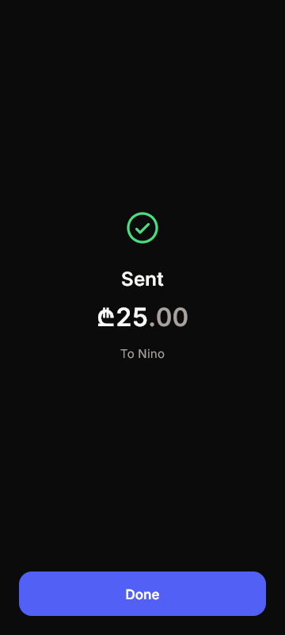
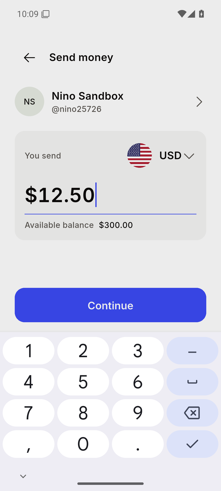
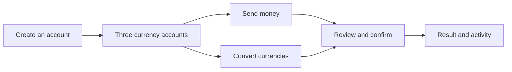
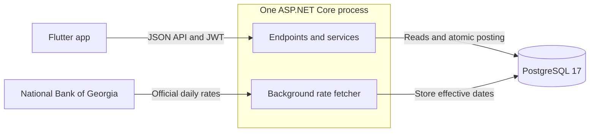

# Tetri

A multi-currency digital bank built with Flutter, ASP.NET Core and a PostgreSQL double-entry ledger. **Sandbox only: no real money.**

| Home · light | Convert · dark | Review · light | Sent · dark |
| :---: | :---: | :---: | :---: |
|  |  |  |  |

*UI previews rendered from the app's Flutter widgets at 360 × 800, using deterministic demo data. [Image provenance](docs/screenshots/previews.md); physical-device checks are recorded separately below.*

<details>
<summary>See the native Android keyboard</summary>



Captured on an Android emulator connected to the local API. This shows entering 12.50 USD before review; the payment shown here has not been confirmed.

</details>

## Try it

[Run the API and Android app locally](#run-locally), then create two users to send money between them. Each new user receives **₾1,000.00, $300.00 and €300.00** in sandbox starter grants.



You can build and install a local debug APK with the commands below. A published release APK and hosted API are **not available yet**; there are no shared demo credentials. Signup, biometric unlock and a 12.50 USD transfer have been verified on a physical Android phone. The live currency-conversion check remains pending because the local NBG feed supplied future-dated rates. [Verification record and remaining gates →](docs/verification.md)

## How the money works

**Money is an integer.** `2500` means 25.00 GEL, represented in JSON as `{ "minor": 2500, "currency": "GEL" }`. Every movement writes a journal with immutable entries that sum to zero within each currency. Cached balances are derived from those entries and checked by reconciliation.

**Concurrent requests cannot spend the same balance twice.** Posting locks all affected accounts in ascending ID order, checks the locked balance, then commits the entries, cached balances and audit row together. PostgreSQL also rejects negative user balances. A 25.00 GEL transfer writes exactly these two entries:

| Account | Currency | Entry in minor units | Balance change |
| --- | --- | ---: | ---: |
| Giorgi's GEL account | GEL | −2500 | −₾25.00 |
| Nino's GEL account | GEL | +2500 | +₾25.00 |
| **Sum** | **GEL** | **0** | **₾0.00** |

**Retries reuse one result.** A short transaction claims the idempotency key; the money transaction locks that claim, verifies its attempt token and commits the successful response with the transfer. Retrying the same key and body replays that response within the 24-hour retention window. Conversions execute the exact amounts from a stored 60-second quote; a completed retry still replays after quote expiry while its key is retained. [The ledger guide](docs/ledger.md) shows the exact rows, lock ordering, takeover protection and rejection handling.

## Proof

[](https://github.com/Ggaming5005/Tetri/actions/workflows/ci.yml)

The concurrency test sends **50 simultaneous requests for 10.00 GEL** against an account holding **100.00 GEL**: exactly 10 succeed, 40 fail with `insufficient_funds`, and the balance ends at zero. It repeats the scenario 20 times; CI runs the entire backend suite three consecutive times.

| Check | Verified result |
| --- | --- |
| Backend | **185 tests**: 56 unit + 129 integration tests against real PostgreSQL; three consecutive CI runs |
| Mobile | **289 tests**, including light/dark Home and Send-review goldens; analysis reports zero issues |
| Startup | Docker Compose builds the API, starts PostgreSQL and passes the HTTP health check |
| Physical Android | Signup, all starter balances, biometric unlock, 12.50 USD transfer, activity and restored session |

[Latest verified CI run](https://github.com/Ggaming5005/Tetri/actions/runs/41689180899) · [Test commands, phase history and open acceptance checks](docs/verification.md)

## Tech stack

- **Mobile:** Flutter 3.47.9, Riverpod, go_router, dio, secure storage and local biometrics. Bundled Inter and Phosphor outline icons; light and dark themes.
- **API:** .NET 10 minimal APIs, EF Core, Npgsql and Serilog. JWT access tokens, rotating refresh tokens, ownership checks and rate limiting.
- **Data and verification:** PostgreSQL 17, Docker Compose, xUnit, FluentAssertions, Testcontainers and GitHub Actions.



PostgreSQL holds accounts, ledger entries, audit records, idempotency keys, quotes and rates in one database. Conversions use stored effective rates; the NBG feed is not called for each payment. The .NET SDK and package versions are pinned, and Compose/tests use PostgreSQL `17.11-alpine`.

## Run locally

Use Docker Desktop with Linux containers, Flutter **3.47.9**, and an Android emulator or USB-connected phone. The .NET 10 SDK is needed only for backend development and tests outside Docker.

### Start the API

From the repository root in PowerShell:

```powershell
Copy-Item .env.example .env
notepad .env
```

Set `POSTGRES_PASSWORD` to a long random local password and `JWT_SIGNING_KEY` to a separate random secret of **at least 32 bytes**, then save:

```powershell
docker compose up --build -d --wait
Invoke-RestMethod http://localhost:5080/api/v1/health
```

Expected response: `{"status":"ok","database":"ok"}`. Startup applies the committed migrations. Ports bind to localhost, `.env` is ignored by Git, and data persists in the `postgres_data` volume. Development [OpenAPI is at localhost:5080/openapi](http://localhost:5080/openapi); the [API guide](docs/api.md) documents requests and responses.

If a fresh database has only future-dated NBG rates, conversions return `503 rates_unavailable` until a rate becomes effective. Previously stored valid rates remain usable during feed failures. Signup, history and same-currency transfers remain available.

### Run the app

For an Android emulator, from the repository root:

```powershell
cd mobile
flutter pub get --enforce-lockfile
flutter run
```

The emulator uses `http://10.0.2.2:5080/api/v1` by default. For a physical phone, enable USB debugging, accept its debugging prompt, and run these commands from `mobile/`, replacing `<device-id>` with the ID listed by `adb`:

```powershell
adb devices
adb -s <device-id> reverse tcp:5080 tcp:5080
flutter run -d <device-id> --dart-define=TETRI_API_URL=http://127.0.0.1:5080/api/v1
```

To build and install the debug APK instead of launching through Flutter, keep the USB reverse rule above and run from `mobile/`:

```powershell
flutter build apk --debug --dart-define=TETRI_API_URL=http://127.0.0.1:5080/api/v1
adb -s <device-id> install -r build/app/outputs/flutter-apk/app-debug.apk
```

Keep Docker Compose running while using the app. Local HTTP is allowed only by the Android debug manifest. With biometrics enabled, the saved session is read only after successful authentication; locking also preserves a pending payment's confirmation key. Refresh retries share a fixed 60-second grace window: if a refresh response is lost and the phone stays offline longer, sign in again.

The debug-only component gallery runs with `flutter run --dart-define=TETRI_GALLERY=true`, or opens by long-pressing the Welcome wordmark. [Build/test commands and golden-test guidance](docs/verification.md#run-the-checks) are in the verification guide. Stop the API from the repository root with `docker compose down`; this preserves database data.

## Project structure

```text
backend/
  Tetri.sln
  src/
    Tetri.Api/              Endpoints, authentication, limits and background jobs
    Tetri.Core/             Domain types, money, FX math and request hashing
    Tetri.Infrastructure/   Persistence, ledger, auth, queries and NBG rates
  tests/                   Unit tests and real PostgreSQL integration tests
mobile/
  lib/design/              Tokens, typography and reusable components
  lib/core/                API client, session, money and errors
  lib/features/            Auth, banking screens and payment flows
  test/                    Unit, widget and golden tests
docs/                      Ledger, API, verification, design notes and previews
.github/workflows/ci.yml    Backend and Flutter verification
docker-compose.yml         Local PostgreSQL and API
AGENTS.MD                  Product specification and phase gates
```

[Ledger](docs/ledger.md) · [API](docs/api.md) · [Verification](docs/verification.md) · [Design review](docs/design-review.md) · [Artwork notes](docs/design-assets.md)
